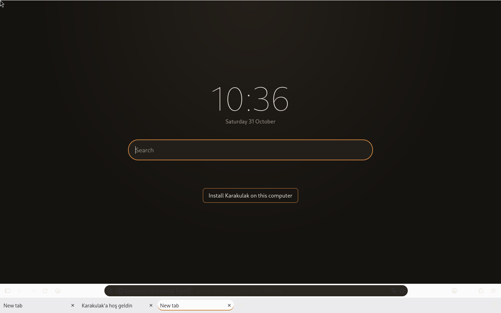
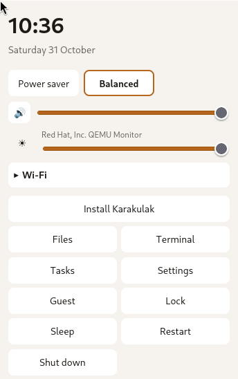
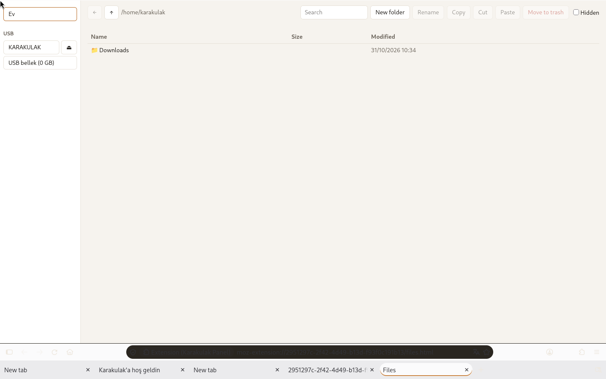
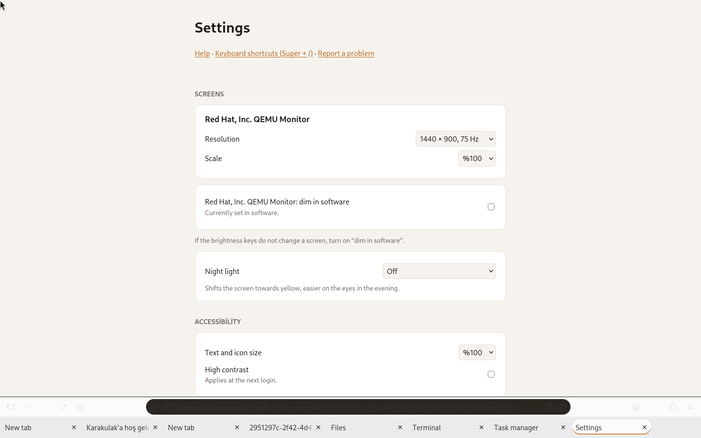
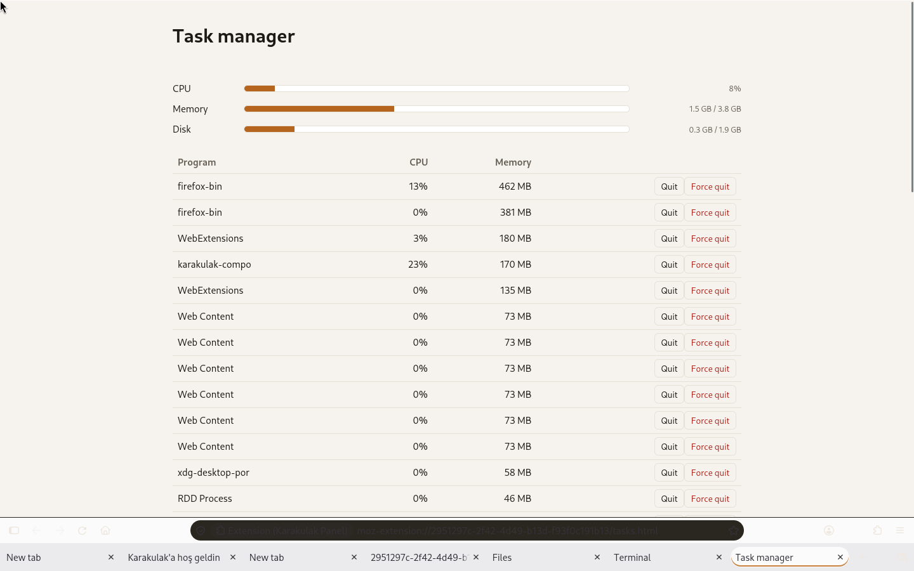
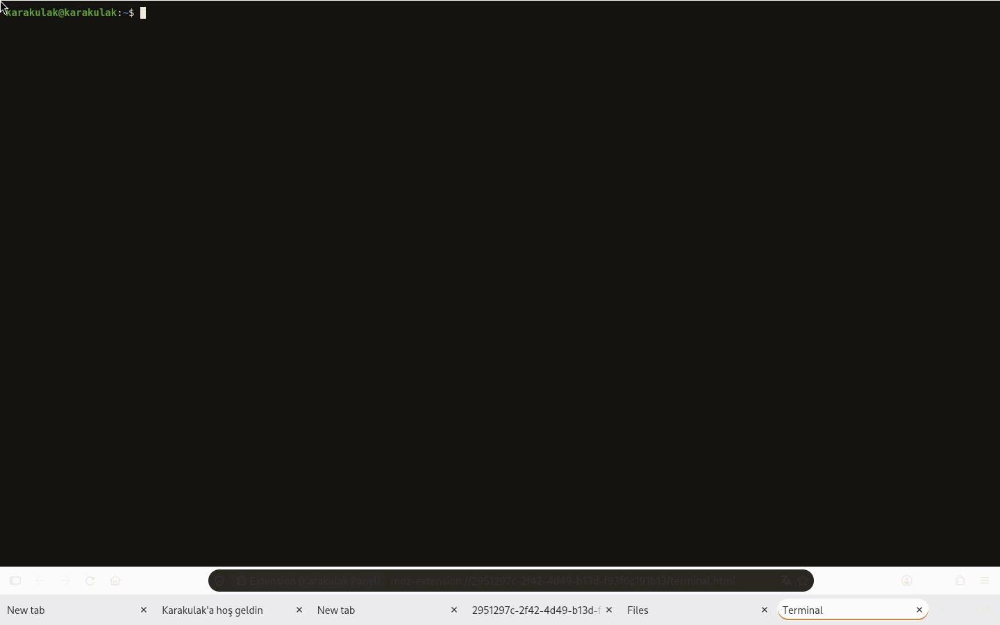
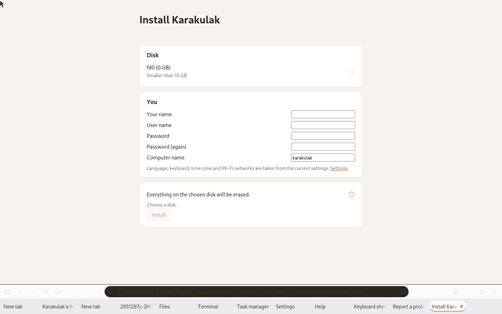

<p align="center"></p>

# Karakulak

**A Linux distribution where the browser is the operating system.**

[Türkçe](README.tr.md)

Karakulak boots straight into Firefox. There is no desktop environment: tabs are
the taskbar, and every tool (file manager, settings, system tray) is a browser
extension.

> *Karakulak* means "black ear" in Turkish. The world knows this animal by the
> name we gave it: the caracal.

<p align="center"></p>

**[Download the ISO](https://github.com/onurbaydas/karakulak/releases/latest)** ·
**[Screenshot tour](https://onurbaydas.github.io/karakulak/)**

## Status

Version 0.9.7: everything for daily use is there. It boots, installs to disk
(BIOS and UEFI) and updates itself; every build is tested in a virtual machine.
What changed in each version is in [CHANGELOG.md](CHANGELOG.md).

The original author has stopped active development. The code is all here and
the build is automatic, so anyone can pick it up: issues labelled
[good first issue](https://github.com/onurbaydas/karakulak/labels/good%20first%20issue)
are small, described and a good place to start.

## Screenshots

| | |
|---|---|
|  |  |
|  |  |
|  |  |

## System requirements

- 64-bit x86 (Intel or AMD), 2 cores
- 4 GB memory
- A disk of at least 10 GB (20 GB recommended)
- BIOS or UEFI

In a virtual machine, choose the virtio display adapter, and a q35 machine
for UEFI.

## What's in it

- Debian (trixie) based ISO: install to disk, or try it live first
- Auto-login into Karakulak's own Wayland compositor (Rust, Smithay), Firefox
  fullscreen on every screen, locked with your password
- Firefox from Mozilla's official APT repository; a welcome page to choose a
  privacy level: standard, strict or paranoid
- Tabs as the taskbar; a panel extension for Wi-Fi, Bluetooth, sound,
  brightness, battery and power
- Files, terminal, tasks and settings as extension pages, backed by a Rust
  daemon (karakulakd) over native messaging
- Signed updates from Karakulak's own APT repository

## Building

Requires a Debian based host (or container) with root access.

```sh
sudo apt install live-build
cargo build --release --manifest-path daemon/Cargo.toml
sudo install -D daemon/target/release/karakulakd config/includes.chroot/usr/bin/karakulakd
lb config
sudo lb build
```

The ISO ends up in the repository root. Every push to `main` also builds an ISO
in GitHub Actions; download it from the run's artifacts.

Test it in a VM:

```sh
qemu-system-x86_64 -enable-kvm -m 4G -cdrom live-image-amd64.hybrid.iso
```

## Contributing

See [CONTRIBUTING.md](CONTRIBUTING.md). Commits must be signed off (DCO).

## License

[GPL-3.0](LICENSE)
