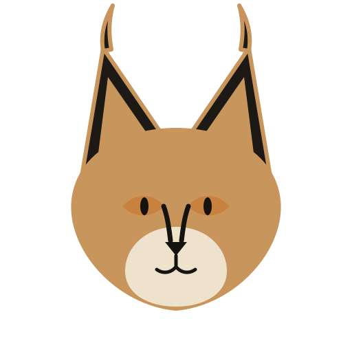

<p align="center"></p>

# Karakulak

**Tarayıcının işletim sistemi olduğu bir Linux dağıtımı.**

[English](README.md)

Karakulak açılır açılmaz Firefox'a düşer. Masaüstü ortamı yoktur: sekmeler görev
çubuğudur, her araç (dosya yöneticisi, ayarlar, sistem tepsisi) bir tarayıcı
eklentisidir.

> *Karakulak*, Türkçede "kara kulak" demek. Dünya bu hayvanı bizim verdiğimiz
> adla tanır: caracal.

## Durum

Erken geliştirme aşamasında. v0.1 hedefi: tam ekran Firefox'la açılan, kurulabilir bir ISO.

## v0.1 kapsamı

- Minimal, Debian (trixie) tabanlı ISO: diske kurulur, istersen önce canlı denenir
- Otomatik giriş, ardından [cage](https://github.com/cage-kiosk/cage) (Wayland) içinde tam ekran Firefox
- Firefox, Mozilla'nın resmi APT deposundan
- İlk açılışta Firefox içinde hoş geldin sayfası, gizlilik seviyesi seçimi: standart, sıkı veya paranoyak
- Sekmeleri görev çubuğu yapan `userChrome.css` teması

Sonra gelecekler: native messaging ile konuşan Rust sistem daemon'u, sistem
eklentileri (dosya yöneticisi vb.), özel açılış ekranı.

## Derleme

Root erişimi olan Debian tabanlı bir sistem (ya da container) gerekir.

```sh
sudo apt install live-build
cargo build --release --manifest-path daemon/Cargo.toml
sudo install -D daemon/target/release/karakulakd config/includes.chroot/usr/bin/karakulakd
lb config
sudo lb build
```

ISO, reponun kök dizinine düşer. `main` dalına yapılan her push GitHub
Actions'ta da ISO üretir. ISO'yu ilgili çalıştırmanın artifact'lerinden
indirebilirsin.

Sanal makinede denemek için:

```sh
qemu-system-x86_64 -enable-kvm -m 4G -cdrom live-image-amd64.hybrid.iso
```

## Katkı

[CONTRIBUTING.md](CONTRIBUTING.md) dosyasına bak. Commit'ler imzalı (DCO) olmalı.

## Lisans

[GPL-3.0](LICENSE)
